# Autoformer Reproduction

[](https://colab.research.google.com/github/HwangDaekyung/Autoformer_reproduction/blob/main/notebooks/Autoformer_from_scratch.ipynb)

**Autoformer: Decomposition Transformers with Auto-Correlation for Long-Term Series Forecasting** (Wu et al., NeurIPS 2021)를 직접 구현하고 논문 결과를 재현한 저장소입니다.

- 논문: https://arxiv.org/abs/2106.13008
- 공식 코드: https://github.com/thuml/Autoformer

공식 코드를 import하지 않고 **데이터 로더, 모델, 학습 루프를 모두 직접 구현**했습니다. 구현이 맞는지는 공식 코드와 같은 가중치를 넣었을 때 출력이 일치하는지로 검증했습니다.

### 모델 흐름 설명 영상 (1분)

[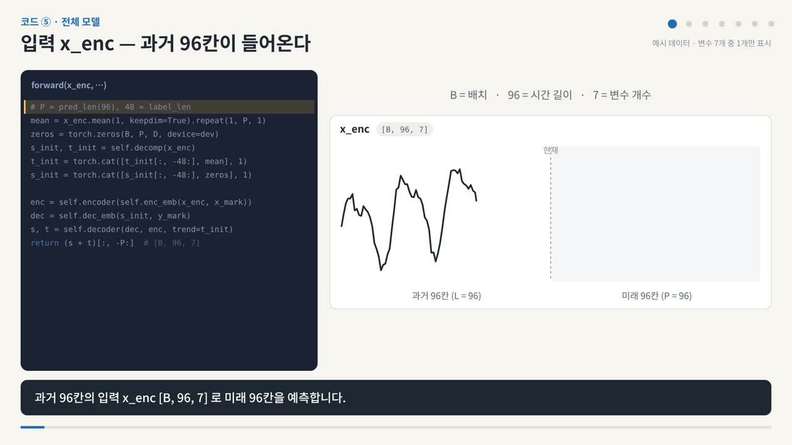](docs/autoformer_flow.mp4)

입력 `x_enc [B, 96, 7]`이 직접 구현한 코드를 지나며 어떻게 바뀌는지 따라가는 영상입니다. 분해(이동평균) → 디코더 초기값(최근 48칸 + 미래 96칸) → 인코더(추세는 버리고 계절만) → Auto-Correlation(top-k 지연으로 roll 후 가중합) → 디코더(추세 세 개 누적) → 계절 + 추세 = 최종 예측 순서로, 각 단계의 코드 줄과 텐서 모양을 함께 보여 줍니다. 이미지를 누르면 영상 파일이 열립니다.

---

## 1. 구성

```
Autoformer_reproduction/
├── README.md
├── docs/
│   └── autoformer_flow.mp4             # 모델 흐름 설명 영상 (1분)
├── notebooks/
│   └── Autoformer_from_scratch.ipynb   # 직접 구현 + 실험 노트북 (Colab), 섹션 12~24는 추가 실험
└── results/
    ├── official_result.txt             # 공식 코드 실행 원본 기록
    ├── official_results.csv            # 공식 코드 결과 정리
    ├── my_results.csv                  # 직접 구현 결과
    └── figures/                        # 시각화 (5장)
```

노트북 구성은 다음과 같습니다.

| 섹션 | 내용 | 논문 대응 |
|---|---|---|
| 1 | 데이터 로더 (분할, 정규화, 시간 특징, 슬라이딩 윈도우) | 4장 Datasets |
| 2 | Series Decomposition 블록 | 3.1절, 식 (1) |
| 3 | Auto-Correlation 메커니즘 (FFT, Top-k 지연, Time Delay Aggregation) | 3.2절, 식 (5)~(8) |
| 4 | 임베딩 (위치 임베딩 없음) | Appendix G.2 |
| 5 | 인코더 · 디코더 | 식 (3), (4) |
| 6 | 전체 모델 (디코더 입력 초기화) | 식 (2), Figure 1 |
| 7 | 공식 코드와 출력 일치 검증 | |
| 8 | 학습 · 평가 루프 | 4장 Implementation details |
| 9 | 실험 실행 | Table 1, Table 10 |
| 10 | 논문 수치와 비교 | Table 10 |
| 11 | 시각화 (예측, 분해, 학습된 주기) | Figure 4, 6, 8 |

## 2. 실행 방법

1. **데이터 준비**: 공식 저장소 README의 Google Drive 링크에서 6개 데이터셋을 받아 Google Drive의 `WORK_DIR/Autoformer/dataset/` 아래에 압축을 풉니다.
   ```
   dataset/
   ├── ETT-small/ETTm2.csv
   ├── electricity/electricity.csv
   ├── exchange_rate/exchange_rate.csv
   ├── traffic/traffic.csv
   ├── weather/weather.csv
   └── illness/national_illness.csv
   ```
2. 위의 **Open In Colab** 배지로 노트북을 열고, 런타임을 GPU로 설정합니다.
3. 섹션 0의 `WORK_DIR`를 본인 Drive 경로로 바꿉니다.
4. `QUICK_TEST = True`로 전체 실행해 오류가 없는지 확인합니다.
5. `QUICK_TEST = False`로 바꾸고 섹션 9의 `run_experiment('ETTm2')` 등을 실행합니다.
   - 결과는 실험마다 `WORK_DIR/my_autoformer/results.csv`에 저장되며, 연결이 끊겨도 다시 실행하면 끝난 실험은 건너뜁니다.
6. 섹션 7(공식 코드 비교)을 실행하려면 공식 저장소를 `WORK_DIR/Autoformer`에 clone해 둡니다.

## 3. 실험 설정

| 항목 | 값 |
|---|---|
| 입력 길이 / 디코더 과거 길이 | 96 / 48 (ILI: 36 / 18) |
| 예측 길이 | 96, 192, 336, 720 (ILI: 24, 36, 48, 60) |
| 모델 | d_model 512, head 8, 인코더 2층, 디코더 1층, d_ff 2048, 이동평균 커널 25, dropout 0.05 |
| 학습 | MSE 손실, Adam (lr 1e-4), batch 32, 최대 10 epoch, early stopping patience 3 |
| 학습률 스케줄 | epoch마다 절반 (공식 코드 `lradj=type1`) |
| 반복 | 3회 (시드 2021로 시작) |

데이터셋별 설정은 공식 `scripts/`를 따랐습니다.

| 데이터셋 | 변수 수 | factor (c) | freq | 비고 |
|---|---|---|---|---|
| ETTm2 | 7 | 1 | t (분) | |
| Electricity | 321 | 3 | h | |
| Exchange | 8 | 3 | h | 예측 192, 336은 1 epoch |
| Traffic | 862 | 3 | h | 3 epoch |
| Weather | 21 | 3 | h | 예측 96은 2 epoch |
| ILI | 7 | 3 | h | 입력 36 |

## 4. 결과

### ETTm2 (다변량, input-96)

| 예측 길이 | 논문 MSE | 공식 코드 MSE | **내 구현 MSE** | 논문 MAE | 공식 코드 MAE | **내 구현 MAE** |
|---|---|---|---|---|---|---|
| 96  | 0.255 ± 0.020 | 0.259 ± 0.033 | **0.228 ± 0.008** | 0.339 ± 0.020 | 0.329 ± 0.020 | **0.312 ± 0.008** |
| 192 | 0.281 ± 0.027 | 0.278 ± 0.001 | **0.274 ± 0.004** | 0.340 ± 0.025 | 0.336 ± 0.001 | **0.333 ± 0.003** |
| 336 | 0.339 ± 0.018 | 0.335 ± 0.004 | **0.339 ± 0.008** | 0.372 ± 0.015 | 0.372 ± 0.003 | **0.374 ± 0.006** |
| 720 | 0.422 ± 0.015 | 0.422 ± 0.007 | **0.427 ± 0.010** | 0.419 ± 0.010 | 0.419 ± 0.006 | **0.421 ± 0.006** |

- 논문 값은 Table 10의 평균 ± 표준편차입니다.
- 공식 코드와 내 구현 값은 같은 환경(Colab A100)에서 얻은 3회 평균 ± 표본 표준편차입니다. 설정은 공식 `scripts/ETT_script/Autoformer_ETTm2.sh`와 같게 맞췄습니다 (`factor 1`, `freq t`).
- 원본 기록: [`results/official_result.txt`](results/official_result.txt), [`results/official_results.csv`](results/official_results.csv), [`results/my_results.csv`](results/my_results.csv)

### 해석

**1. 공식 코드는 논문을 재현했습니다.** 8개 수치 모두 논문의 평균 ± 표준편차 범위 안에 들어왔고, 예측 336·720은 평균이 소수점 셋째 자리까지 거의 같습니다.

**2. 직접 구현도 예측 192·336·720에서 논문을 재현했습니다.** 6개 수치 모두 논문 범위 안이고, 공식 코드와의 평균 차이는 MSE 기준 0.004 이하입니다.

**3. 예측 96에서는 내 구현이 논문보다 낮은(좋은) 오차를 냈습니다.** MSE 0.228은 논문 범위(0.235~0.275)의 아래쪽 바깥입니다. 다만 이 차이는 구현 오류라기보다 **실행마다 결과가 크게 흔들리는 설정**에서 생긴 것으로 봅니다.
- 공식 코드도 예측 96에서만 3회 결과가 0.229, 0.254, 0.293으로 크게 흔들렸고, 첫 실행(0.229)은 내 구현 평균과 거의 같습니다.
- 논문 Table 10에서도 예측 96의 표준편차가 상대적으로 큽니다.
- 섹션 7에서 같은 가중치·같은 입력에 대해 두 구현의 출력이 일치함을 확인했으므로, 결과 차이는 모델 정의가 아니라 무작위성(초기화, 배치 순서, GPU 연산)에서 온 것으로 해석할 수 있습니다.
- 3회 반복은 표본이 적어서, 시드를 늘려 반복하면 두 구현의 분포가 겹치는지 더 확실히 확인할 수 있습니다.

**4. 학습이 매우 빨리 수렴합니다.** 내 구현 12회 실험 중 10회가 **1 epoch에서 검증 손실이 가장 낮았고**, early stopping(patience 3)으로 4 epoch 만에 멈췄습니다. 학습률이 epoch마다 절반으로 줄어드는 스케줄과 맞물려, 사실상 첫 epoch의 모델이 최종 모델이 됩니다.

**5. 학습 시간**: 실험 1회당 평균 145초(예측 96) ~ 366초(예측 720), 12회 전체 약 46분 (A100). 내 구현은 epoch마다 테스트 구간을 평가하지 않아 공식 코드보다 짧습니다.

### 6개 데이터셋 전체 (직접 구현, 다변량)

| 데이터셋 | 예측 | 논문 MSE | **내 구현 MSE** | 논문 MAE | **내 구현 MAE** | 논문 범위 안 (MSE) |
|---|---|---|---|---|---|---|
| ETTm2 | 96 | 0.255 ± 0.020 | 0.228 ± 0.008 | 0.339 ± 0.020 | 0.312 ± 0.008 | 아래쪽 바깥 (더 좋음) |
| ETTm2 | 192 | 0.281 ± 0.027 | 0.274 ± 0.004 | 0.340 ± 0.025 | 0.333 ± 0.003 | 안 |
| ETTm2 | 336 | 0.339 ± 0.018 | 0.339 ± 0.008 | 0.372 ± 0.015 | 0.374 ± 0.006 | 안 |
| ETTm2 | 720 | 0.422 ± 0.015 | 0.427 ± 0.010 | 0.419 ± 0.010 | 0.421 ± 0.006 | 안 |
| Electricity | 96 | 0.201 ± 0.003 | 0.204 ± 0.011 | 0.317 ± 0.004 | 0.319 ± 0.011 | 안 |
| Electricity | 192 | 0.222 ± 0.003 | 0.228 ± 0.002 | 0.334 ± 0.004 | 0.337 ± 0.002 | 위쪽 바깥 (+0.006) |
| Electricity | 336 | 0.231 ± 0.006 | 0.246 ± 0.004 | 0.338 ± 0.004 | 0.350 ± 0.005 | 위쪽 바깥 (+0.015) |
| Electricity | 720 | 0.254 ± 0.007 | 0.352 ± 0.072 | 0.361 ± 0.008 | 0.412 ± 0.033 | 위쪽 바깥 (+0.098) |
| Exchange | 96 | 0.197 ± 0.019 | 0.157 ± 0.012 | 0.323 ± 0.012 | 0.289 ± 0.012 | 아래쪽 바깥 (더 좋음) |
| Exchange | 192 | 0.300 ± 0.020 | 0.309 ± 0.037 | 0.369 ± 0.016 | 0.403 ± 0.023 | 안 |
| Exchange | 336 | 0.509 ± 0.041 | 0.435 ± 0.025 | 0.524 ± 0.016 | 0.492 ± 0.016 | 아래쪽 바깥 (더 좋음) |
| Exchange | 720 | 1.447 ± 0.084 | 1.128 ± 0.028 | 0.941 ± 0.028 | 0.826 ± 0.014 | 아래쪽 바깥 (더 좋음) |
| Traffic | 96 | 0.613 ± 0.028 | 0.631 ± 0.007 | 0.388 ± 0.012 | 0.395 ± 0.002 | 안 |
| Traffic | 192 | 0.616 ± 0.042 | 0.650 ± 0.014 | 0.382 ± 0.020 | 0.410 ± 0.009 | 안 |
| Traffic | 336 | 0.622 ± 0.016 | 0.639 ± 0.017 | 0.337 ± 0.011 | 0.401 ± 0.013 | 위쪽 바깥 (+0.017) |
| Traffic | 720 | 0.660 ± 0.025 | 0.686 ± 0.036 | 0.408 ± 0.015 | 0.426 ± 0.024 | 위쪽 바깥 (+0.026) |
| Weather | 96 | 0.266 ± 0.007 | 0.287 ± 0.026 | 0.336 ± 0.006 | 0.351 ± 0.015 | 위쪽 바깥 (+0.021) |
| Weather | 192 | 0.307 ± 0.024 | 0.292 ± 0.006 | 0.367 ± 0.022 | 0.351 ± 0.003 | 안 |
| Weather | 336 | 0.359 ± 0.035 | 0.355 ± 0.011 | 0.395 ± 0.031 | 0.389 ± 0.010 | 안 |
| Weather | 720 | 0.419 ± 0.017 | 0.431 ± 0.019 | 0.428 ± 0.014 | 0.435 ± 0.015 | 안 |
| ILI | 24 | 3.483 ± 0.107 | 3.837 ± 0.255 | 1.287 ± 0.018 | 1.410 ± 0.062 | 위쪽 바깥 (+0.354) |
| ILI | 36 | 3.103 ± 0.139 | 3.564 ± 0.125 | 1.148 ± 0.025 | 1.312 ± 0.028 | 위쪽 바깥 (+0.461) |
| ILI | 48 | 2.669 ± 0.151 | 3.141 ± 0.099 | 1.085 ± 0.037 | 1.217 ± 0.024 | 위쪽 바깥 (+0.472) |
| ILI | 60 | 2.770 ± 0.085 | 3.194 ± 0.228 | 1.125 ± 0.019 | 1.226 ± 0.019 | 위쪽 바깥 (+0.424) |

- 3회 평균 ± 표본 표준편차, Colab A100. 원본: [`results/my_results.csv`](results/my_results.csv) (72회 실험, 학습 시간 합계 약 3.5시간)
- 같은 환경의 공식 코드 결과는 ETTm2와 ILI만 있습니다.

**해석**

- **24개 설정 중 MSE 기준 10개가 논문 범위 안**, 4개는 논문보다 좋고(범위 아래쪽), 10개는 논문보다 나쁩니다(범위 위쪽).
- **Weather·ETTm2·Traffic(96, 192)은 대체로 재현**되었습니다.
- **Exchange는 논문보다 오차가 크게 낮습니다**(예측 720: 1.128 vs 1.447). 공식 스크립트대로 예측 192·336은 1 epoch만 학습했는데도 그렇습니다. 실행 환경(라이브러리 버전 등)에 따른 차이일 수 있으나 원인은 확인하지 못했습니다.
- **ILI는 4개 예측 길이 모두 논문보다 MSE가 0.35~0.47 높습니다.** 3회 반복 모두 같은 방향이라 단순한 우연으로 보기는 어렵습니다. ILI는 전체가 966개 시점(주 단위)뿐이라 테스트 샘플이 170개 남짓이고 결과가 민감합니다.
- **Electricity 720은 실행마다 결과가 크게 흔들렸습니다**(0.291, 0.334, 0.431).
- **Traffic 336의 MAE**는 논문(0.337)보다 0.064 높습니다. 논문 표에서는 Traffic MAE가 192(0.382)보다 336(0.337)에서 오히려 낮아지는 특이한 패턴을 보입니다.

**ILI 공식 코드 비교 (같은 Colab A100 환경, 3회 평균 MSE)**

| 예측 | 논문 | 공식 코드 | 내 구현 |
|---|---|---|---|
| 24 | 3.483 ± 0.107 | 3.310 ± 0.093 | 3.837 ± 0.255 |
| 36 | 3.103 ± 0.139 | 3.258 ± 0.042 | 3.564 ± 0.125 |
| 48 | 2.669 ± 0.151 | 3.252 ± 0.153 | 3.141 ± 0.099 |
| 60 | 2.770 ± 0.085 | 2.923 ± 0.143 | 3.194 ± 0.228 |

- **공식 코드도 ILI는 4개 모두 논문 범위 밖**입니다(24는 더 좋고, 36·48·60은 나쁨). ILI는 이 환경에서 공식 코드로도 논문 수치가 그대로 나오지 않습니다.
- 다만 내 구현은 공식 코드보다 평균 약 0.25 높습니다(48만 더 낮음). 3회 반복으로는 무작위성인지 확정하기 어려워, 반복 횟수를 늘려 확인할 필요가 있습니다.

**구현이 원인인지 확인한 것**: 모델은 공식 코드와 같은 가중치에서 출력이 일치하고(6장), 데이터 로더도 ETTm2와 custom 형식(ILI와 같은 구조의 인공 데이터) 모두에서 공식 로더와 샘플 수·값이 일치함을 확인했습니다. 남은 차이를 가르려면 **같은 환경에서 공식 코드로 ILI·Electricity를 돌려 비교**하는 것이 다음 단계입니다. 공식 코드도 같은 결과가 나오면 환경·무작위성 문제, 다르게 나오면 학습 과정의 차이입니다.

### 재현 범위

논문의 실험 중 직접 구현한 모델만으로 할 수 있는 것은 모두 진행했습니다. 비교 모델(Informer, Reformer 등)이 따로 필요한 실험은 다음 단계입니다.

| 구분 | 실험 | 내용 | 상태 |
|---|---|---|---|
| 본문 | Table 1 | 다변량, 6개 데이터셋 × 예측 4개 (+ 비교 모델 7개) | ✅ Autoformer 완료 (72회) · ⬜ 비교 모델 |
| 본문 | Table 2 | 단변량 (ETTm2, Exchange) | ✅ Autoformer 완료 (24회) · ⬜ 비교 모델 |
| 본문 | Table 3 | 분해 구조 ablation (Transformer·Informer·LogTrans·Reformer에 적용) | ⬜ 비교 모델 필요 |
| 본문 | Table 4 | Auto-Correlation ↔ Full / LogSparse / LSH / ProbSparse Attention | ✅ 45회 (각 1회) |
| 본문 | Figure 4 | 디코더 계절·추세 시각화 | ✅ (5-4) |
| 본문 | Figure 5 | 학습된 의존성 시각화 (Attention 계열과 비교) | ✅ |
| 본문 | Figure 6 | 학습된 지연 통계 | ✅ Autoformer 디코더 (5-5) |
| 본문 | Figure 7 | 메모리·실행 시간 효율 분석 | ✅ |
| 부록 | Table 5 | ETT 4종(ETTh1·h2·m1·m2) 전체 벤치마크 | ✅ 60회 |
| 부록 | Table 6 | 하이퍼파라미터 c 민감도 | ✅ 90회 |
| 부록 | Table 7 | 입력 길이에 따른 성능 | ✅ 36회 |
| 부록 | Table 8 | 디코더 입력의 과거 정보 길이 | ✅ 9회 |
| 부록 | Table 9 | 사전 분해(STL 등) + 두 Transformer와 비교 | ⬜ 비교 모델 필요 |
| 부록 | Table 10 | Table 1의 평균 ± 표준편차 | ✅ 재현 판정 기준으로 사용 |
| 부록 | Table 11 | COVID-19 데이터 | ⬜ |
| 부록 | Figure 8~13 | 예측 사례 (다변량·단변량) | ✅ ETTm2 다변량만 (5-3) |

### 추가 실험 결과 (노트북 섹션 12~24)

같은 노트북 뒤쪽에 직접 구현한 모델만으로 가능한 실험(Figure 7, Table 4, Figure 5, Table 6, 7, 8, 5, 2)을 이어 붙였습니다. 섹션 1~8의 모델·로더·학습 함수를 그대로 쓰고, 단변량 지원 · 디코더 과거 길이 0 지원 · Attention 교체(Full / LogSparse / LSH / ProbSparse)만 덧붙였습니다.

- 실험 1회가 끝날 때마다 결과를 CSV에 저장하고, **epoch마다 학습 상태(가중치·옵티마이저·early stopping·난수 상태)를 Drive에 저장**합니다. 끊기면 "모두 실행"만 다시 누르면 끝난 실험은 건너뛰고, 진행 중이던 실험은 마지막 epoch 다음부터 이어갑니다. 중단 후 이어서 학습한 결과가 끊기지 않은 학습과 같음을 확인했습니다(CPU, 같은 시드). 실제 실행에서는 Table 5의 1회가 이어서 학습되었습니다.
- 원본 결과: [`results/extra/results/`](results/extra/results) (실험 1회 = CSV 한 줄, `*_summary.csv`는 3회 평균), 그림: [`results/extra/figures/`](results/extra/figures)
- **판정 기준**: 이 표들은 논문에 표준편차가 없어서, 논문 값과의 차이가 **±5% 이내이거나 내 3회 결과의 2σ 이내이면 ≈(재현)**, 그보다 크면 ▲(논문보다 나쁨) / ▼(논문보다 좋음)로 표시했습니다. 모든 값은 MSE, 낮을수록 좋습니다.

| 실험 | 논문의 주장 | 판정 |
|---|---|---|
| Table 4 | Auto-Correlation이 모든 설정에서 가장 정확 | ⚠️ 부분 재현: Auto-Correlation 수치는 재현(입력 96·192), 순위는 재현 안 됨 |
| Figure 5 | Auto-Correlation은 주기상 같은 위치의 구간을 본다 | ⚠️ 부분 일치: 구간 단위는 맞음, 입력이 하루라 주기 확인은 한계 |
| Figure 7 | 길이에 대해 O(L log L) | ✅ 재현 |
| Table 5 | ETT 4종 모두에서 좋은 성능 | ✅ 20개 중 17개 ≈ |
| Table 6 | c에 크게 민감하지 않다 | ✅ 경향 재현 (논문보다 더 평탄) |
| Table 7 | 입력이 길어져도 성능이 유지된다 | ⚠️ Electricity는 재현, ETTm2 입력 336·720과 ILI는 나쁨 |
| Table 8 | 디코더에 과거를 넣으면 조금 좋아지고 메모리는 조금 늘어난다 | ✅ 3개 모두 ≈, 메모리 경향 일치 |
| Table 2 | 단변량에서도 좋은 성능 | ⚠️ 8개 중 5개 ≈, ETTm2 96·Exchange 720은 나쁨 |

#### Table 4 — Attention 교체 (ETTm2 다변량, 각 1회)

괄호 안이 논문 값, 굵은 글씨가 각 설정의 1위입니다. `-`는 논문에서 메모리 부족(OOM)이었던 칸입니다.

| 메커니즘 | I96-O336 | I96-O720 | I96-O1440 | I192-O336 | I192-O720 | I192-O1440 | I336-O336 | I336-O720 | I336-O1440 |
|---|---|---|---|---|---|---|---|---|---|
| Auto-Correlation | 0.338 (0.339) | **0.422** (0.422) | 0.502 (0.555) | 0.346 (0.355) | 0.431 (0.429) | **0.483** (0.503) | 0.484 (0.361) | 1.212 (0.425) | 0.471 (0.574) |
| Full | 0.419 (0.375) | 0.464 (0.537) | 0.587 (0.667) | 0.382 (0.450) | 0.509 (0.554) | 0.587 (-) | **0.362** (0.501) | 0.601 (0.647) | 0.519 (-) |
| LogSparse | 0.350 (0.362) | 0.463 (0.539) | 0.540 (0.582) | 0.415 (0.420) | 0.458 (0.552) | 0.625 (0.958) | 0.422 (0.474) | 0.467 (0.601) | 0.525 (-) |
| LSH | **0.321** (0.366) | 0.424 (0.502) | **0.489** (0.663) | **0.338** (0.407) | **0.421** (0.636) | 0.498 (1.069) | 0.364 (0.442) | **0.417** (0.615) | **0.455** (-) |
| ProbSparse | 0.348 (0.481) | 0.438 (0.822) | 0.546 (0.715) | 0.597 (0.404) | 0.454 (1.148) | 0.555 (0.732) | 0.377 (0.417) | 0.502 (0.631) | 0.500 (1.133) |

- Auto-Correlation은 입력 96·192에서 논문과 거의 같거나 더 좋았습니다(−9.5% ~ +0.5%).
- 그런데 **비교 대상 4종이 논문보다 크게 좋아져서**(설정별 중앙값 Full −12%, LogSparse −13%, LSH −22%, ProbSparse −24%) 순위가 바뀌었습니다. Auto-Correlation은 1위 2개, 2위 5개(1위와 0.008~0.018 차이), 5위 2개입니다.
- 처음 세운 가설(공식 코드는 Full·ProbSparse 디코더에 인과 마스크를 쓰고 ProbSparse factor가 1인데, 여기서는 마스크 없이 factor 5로 돌렸다)은 **섹션 23-2에서 기각**되었습니다. 공식 설정으로 바꿔도 비교 대상은 나빠지지 않았고 오히려 조금 좋아졌습니다(아래 점검 23-2).
- 입력 336의 두 칸(0.484, 1.212)은 아래 Table 7에서 3회 반복해도 같은 방향으로 나빠, 한 번의 학습 실패가 아니라 **긴 입력에서 생기는 학습 불안정**으로 보입니다(점검 23-3).

#### Figure 5 — 학습된 의존성 (ETTm2 96→336, 테스트 샘플 1개)

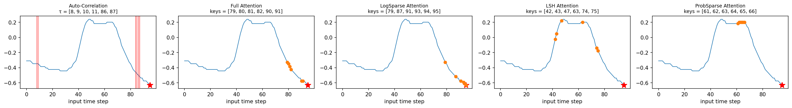

Auto-Correlation은 지연 τ = 8~11, 86~87을 골랐고(86·87은 96−τ와 대칭), Full·LogSparse는 바로 앞 79~95, LSH는 42~75에 흩어지고, ProbSparse는 평평한 꼭대기 61~66에 몰렸습니다. 다만 입력 96칸이 딱 하루라 "하루 전 같은 시각"이 입력에 없어서, 일주기를 짚는지는 이 설정으로 확인할 수 없습니다.

#### Figure 7 — 효율 (A100 40GB)

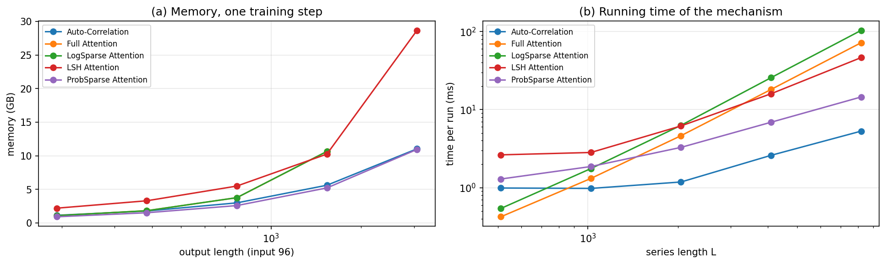

- 메모리: 출력 길이 192 → 3072에서 Auto-Correlation은 1.16 → 11.30 GB(두 배당 약 ×1.77), Full·LogSparse는 3072에서 OOM입니다.
- 시간: Auto-Correlation은 0.99 → 5.30 ms로 완만하게 늘고, Full은 두 배마다 약 4배씩 늘어 길이 8192에서 약 14배 차이(5.3 ms 대 71.8 ms)입니다. 짧은 길이(512)에서는 Full이 더 빠릅니다.

#### Table 5 — ETT 4종 전체 (다변량, 입력 96)

20개 중 17개 ≈, 3개는 차이가 ±5%를 조금 넘었습니다(ETTm2 24는 +5.4%, ETTm1 672와 ETTm2 672는 논문보다 좋음).

<details><summary>전체 표 보기</summary>

| 데이터 | 예측 길이 | 논문 MSE | 내 MSE (3회 평균 ± 표준편차) | 차이 | 판정 |
|---|---|---|---|---|---|
| ETTh1 | 24 | 0.384 | 0.389 ± 0.012 | +1.4% | ≈ |
| ETTh1 | 48 | 0.392 | 0.410 ± 0.025 | +4.5% | ≈ |
| ETTh1 | 168 | 0.490 | 0.468 ± 0.007 | -4.5% | ≈ |
| ETTh1 | 336 | 0.505 | 0.516 ± 0.009 | +2.2% | ≈ |
| ETTh1 | 720 | 0.498 | 0.506 ± 0.029 | +1.5% | ≈ |
| ETTh2 | 24 | 0.261 | 0.279 ± 0.023 | +6.7% | ≈ |
| ETTh2 | 48 | 0.312 | 0.310 ± 0.005 | -0.5% | ≈ |
| ETTh2 | 168 | 0.457 | 0.456 ± 0.016 | -0.2% | ≈ |
| ETTh2 | 336 | 0.471 | 0.483 ± 0.014 | +2.6% | ≈ |
| ETTh2 | 720 | 0.474 | 0.475 ± 0.006 | +0.2% | ≈ |
| ETTm1 | 24 | 0.383 | 0.397 ± 0.043 | +3.6% | ≈ |
| ETTm1 | 48 | 0.454 | 0.488 ± 0.047 | +7.4% | ≈ |
| ETTm1 | 96 | 0.481 | 0.499 ± 0.068 | +3.8% | ≈ |
| ETTm1 | 288 | 0.634 | 0.624 ± 0.087 | -1.6% | ≈ |
| ETTm1 | 672 | 0.606 | 0.539 ± 0.019 | -11.0% | ▼ 좋음 |
| ETTm2 | 24 | 0.153 | 0.161 ± 0.003 | +5.4% | ▲ 나쁨 |
| ETTm2 | 48 | 0.178 | 0.194 ± 0.014 | +9.0% | ≈ |
| ETTm2 | 96 | 0.255 | 0.249 ± 0.025 | -2.2% | ≈ |
| ETTm2 | 288 | 0.342 | 0.323 ± 0.010 | -5.5% | ≈ |
| ETTm2 | 672 | 0.434 | 0.411 ± 0.004 | -5.4% | ▼ 좋음 |

</details>

#### Table 6 — 하이퍼파라미터 c 민감도 (괄호 안 논문 값, 굵은 글씨는 데이터별 최소)

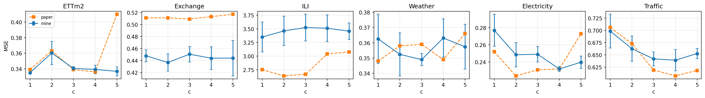

| 데이터 (입력→예측) | c=1 | c=2 | c=3 | c=4 | c=5 |
|---|---|---|---|---|---|
| ETTm2 (96→336) | **0.335** (0.339) | 0.360 (0.363) | 0.340 (0.339) | 0.339 (0.336) | 0.337 (0.410) |
| Electricity (96→336) | 0.277 (0.252) | 0.249 (0.224) | 0.249 (0.231) | **0.232** (0.232) | 0.240 (0.273) |
| Exchange (96→336) | 0.448 (0.511) | **0.437** (0.511) | 0.450 (0.509) | 0.444 (0.513) | 0.444 (0.517) |
| Traffic (96→336) | 0.699 (0.706) | 0.663 (0.673) | 0.642 (0.619) | **0.639** (0.607) | 0.653 (0.618) |
| Weather (96→336) | 0.363 (0.348) | 0.352 (0.358) | **0.349** (0.359) | 0.363 (0.349) | 0.357 (0.366) |
| ILI (36→48) | **3.349** (2.754) | 3.460 (2.641) | 3.523 (2.669) | 3.510 (3.041) | 3.457 (3.076) |

- ETTm2·Traffic·Weather는 논문과 거의 같습니다. 논문의 ETTm2 c=5 급등(0.410)은 재현되지 않았고, 내 결과는 c에 더 둔감했습니다.
- Exchange는 모든 c에서 논문보다 11~15% 좋았습니다(공식 설정대로 1 epoch만 학습).
- ILI는 모든 c에서 논문보다 나빴습니다(아래 Table 7, 주 실험과 같은 경향).
- 결론: "c를 1~5 사이에서 바꿔도 성능이 크게 흔들리지 않는다"는 주장은 재현되었습니다.

#### Table 7 — 입력 길이 (예측: ETTm2·Electricity 336, ILI 48)

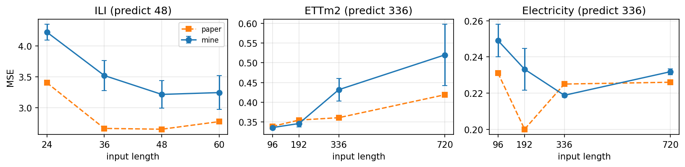

| 데이터 | 입력 길이 | 논문 MSE | 내 MSE (3회 평균 ± 표준편차) | 차이 | 판정 |
|---|---|---|---|---|---|
| ETTm2 | 96 | 0.339 | 0.336 ± 0.004 | -0.9% | ≈ |
| ETTm2 | 192 | 0.355 | 0.346 ± 0.009 | -2.5% | ≈ |
| ETTm2 | 336 | 0.361 | 0.432 ± 0.028 | +19.6% | ▲ 나쁨 |
| ETTm2 | 720 | 0.419 | 0.520 ± 0.078 | +24.1% | ≈ |
| Electricity | 96 | 0.231 | 0.249 ± 0.009 | +7.8% | ≈ |
| Electricity | 192 | 0.200 | 0.233 ± 0.011 | +16.6% | ▲ 나쁨 |
| Electricity | 336 | 0.225 | 0.219 ± 0.001 | -2.8% | ≈ |
| Electricity | 720 | 0.226 | 0.232 ± 0.002 | +2.6% | ≈ |
| ILI | 24 | 3.406 | 4.223 ± 0.128 | +24.0% | ▲ 나쁨 |
| ILI | 36 | 2.669 | 3.523 ± 0.243 | +32.0% | ▲ 나쁨 |
| ILI | 48 | 2.656 | 3.218 ± 0.220 | +21.2% | ▲ 나쁨 |
| ILI | 60 | 2.779 | 3.247 ± 0.274 | +16.8% | ≈ |

- Electricity는 입력이 길어져도 성능이 유지되어 논문과 같은 경향입니다.
- **ETTm2는 입력 336·720에서 크게 나빠졌습니다**(+20%, +24%). Table 4의 입력 336 Auto-Correlation 결과와 같은 방향이라, 긴 입력에서 학습이 불안정해지는 원인을 따로 확인해야 합니다.
- ILI는 모든 입력 길이에서 나빴습니다. 학습률을 epoch마다 절반으로 줄이는 스케줄 때문에 덜 학습된 것이 일부 원인이었습니다(점검 23-1).

#### Table 8 — 디코더에 넣는 과거 길이 (ETTm2 96→336)

| 디코더 과거 길이 | 논문 MSE | 내 MSE | 판정 | 논문 메모리 (MB) | 내 최대 메모리 (MB) |
|---|---|---|---|---|---|
| 0 | 0.360 | 0.346 ± 0.010 | ≈ | 3029 | 1536 |
| 48 | 0.339 | 0.340 ± 0.006 | ≈ | 3271 | 1658 |
| 96 | 0.333 | 0.349 ± 0.027 | ≈ | 3599 | 1893 |

세 설정 모두 논문과 ≈입니다. 과거 길이가 늘수록 메모리가 조금씩 늘어나는 경향도 같습니다(절대값은 GPU·라이브러리 차이로 다름). 0 → 48에서 조금 좋아지는 것도 같지만, 48 → 96에서 더 좋아지는 것은 재현되지 않았습니다(차이가 표준편차 안).

#### Table 2 — 단변량 (OT 하나만 입력·예측)

| 데이터 | 예측 길이 | 논문 MSE | 내 MSE (3회 평균 ± 표준편차) | 차이 | 판정 |
|---|---|---|---|---|---|
| ETTm2 | 96 | 0.065 | 0.088 ± 0.002 | +35.0% | ▲ 나쁨 |
| ETTm2 | 192 | 0.118 | 0.122 ± 0.006 | +3.4% | ≈ |
| ETTm2 | 336 | 0.154 | 0.154 ± 0.003 | +0.2% | ≈ |
| ETTm2 | 720 | 0.182 | 0.203 ± 0.011 | +11.5% | ≈ |
| Exchange | 96 | 0.241 | 0.166 ± 0.004 | -31.0% | ▼ 좋음 |
| Exchange | 192 | 0.273 | 0.348 ± 0.090 | +27.5% | ≈ |
| Exchange | 336 | 0.508 | 0.622 ± 0.087 | +22.5% | ≈ |
| Exchange | 720 | 0.991 | 1.244 ± 0.037 | +25.5% | ▲ 나쁨 |

- ETTm2 192·336은 논문과 같습니다. ETTm2 96은 +35%로, 최적 epoch이 평균 6.3(한 번은 상한 10)이라 덜 학습된 상태에서 멈춘 것으로 보입니다.
- Exchange는 96만 논문보다 좋고 192~720은 나쁩니다. 실행마다 흔들림이 커서(192: 0.286~0.452) 3회로는 판단이 어렵습니다.

#### 점검 실험 (노트북 섹션 23-1 ~ 23-4)

위 결과에서 생긴 의문 네 가지를 학습 설정만 바꿔 확인했습니다. 모두 3회 평균입니다(23-2는 1회, 23-4는 1회 학습 후 테스트 구간 전체).

| 섹션 | 의문 | 결과 | 판정 |
|---|---|---|---|
| 23-1 | ILI는 왜 나쁜가 | 학습률 고정이면 4개 모두 5~10% 좋아짐, epoch 상한만 늘리면 변화 없음 | ✅ 원인 일부 확인: **학습률 절반 스케줄** |
| 23-2 | Table 4 순위는 왜 바뀌었나 | 공식 설정(인과 마스크 + factor 1)에서도 비교 대상이 나빠지지 않음, Auto-Correlation 1위는 여전히 2개 | ❌ 가설 기각: 순위 변화는 설정 차이 때문이 아님 |
| 23-3 | ETTm2 긴 입력은 왜 나쁜가 | 입력 720은 학습률을 낮추거나 디코더 과거를 48로 줄이면 논문 수준, 입력 336은 그대로 | ⚠️ 720은 해결, 336은 미해결 |
| 23-4 | 인코더도 하루 주기를 고르나 | 데이터 자기상관은 96의 배수에서 봉우리인데, 인코더는 입력 길이와 상관없이 **지연 8~11**(2~3시간)과 그 거울상만 고름 | ❌ 인코더 수준에서는 주기를 고르지 않음 |

**23-1 · ILI: epoch 상한과 학습률 스케줄** (입력 36)

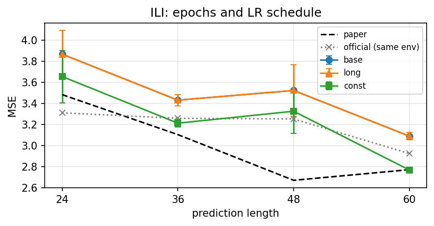

| 방식 | 24 | 36 | 48 | 60 |
|---|---|---|---|---|
| base (상한 10, 학습률 절반씩) | 3.868 | 3.430 | 3.523 | 3.088 |
| long (상한 30, 학습률 절반씩) | 3.866 | 3.430 | 3.523 | 3.088 |
| **const (상한 30, 학습률 고정)** | **3.655** | **3.212** | **3.325** | **2.766** |
| 논문 | 3.483 | 3.103 | 2.669 | 2.770 |
| 같은 환경의 공식 코드 | 3.310 | 3.258 | 3.252 | 2.923 |

- 상한을 30으로 늘려도(long) 결과가 같았습니다. 학습률이 8 epoch쯤이면 처음의 1/128로 줄어 사실상 멈추고, 조기 종료가 상한보다 먼저 걸리기 때문입니다.
- 학습률을 고정하면(const) 4개 모두 좋아졌고, 36·60은 같은 환경의 공식 코드보다도 좋아졌습니다. 60은 논문과 같습니다(2.766 vs 2.770).
- 48만은 여전히 논문보다 25% 나쁩니다. 같은 환경의 공식 코드도 3.252라서 이 부분은 환경 차이로 봅니다.

**23-2 · Table 4를 공식 코드 쪽 설정으로** (ETTm2, 각 1회)

| 시나리오 | Auto-Correlation 순위 (9개 설정) | 1위 횟수 |
|---|---|---|
| 논문 | 1, 1, 1, 1, 1, 1, 1, 1, 1 | 9 |
| 섹션 17 (마스크 없음, ProbSparse factor 5) | 2, 1, 2, 2, 2, 1, 5, 5, 2 | 2 |
| ProbSparse factor 1 | 3, 1, 2, 2, 3, 2, 5, 5, 3 | 1 |
| Full·ProbSparse 디코더 인과 마스크 + factor 1 | 3, 1, 2, 2, 2, 1, 5, 5, 2 | 2 |

- 인과 마스크를 넣은 Full은 설정별 중앙값 −2.2%로 오히려 조금 좋아졌고(입력 96→336은 0.419 → 0.338), ProbSparse도 factor 1에서 −7.5%(마스크까지 넣으면 −3.4%) 좋아졌습니다. 그래도 논문 값보다는 Full −12.5%, ProbSparse −29~30%로 여전히 훨씬 좋습니다.
- 즉 **비교 대상이 논문보다 좋게 나온 것은 마스크·factor 설정 때문이 아닙니다.** Table 4의 비교 대상 코드는 공개되지 않아서 남은 차이의 원인은 확인할 수 없습니다. 논문의 "Auto-Correlation이 항상 가장 정확하다"는 이 환경에서 재현되지 않았고, Auto-Correlation은 LSH와 함께 최상위권이라고 결론 내립니다.
- 주의: 공식 ProbSparse는 마스크를 쓸 때 고르지 않은 쿼리를 V의 누적합으로 채우는데, Autoformer 디코더에는 LayerNorm이 없어 발산했습니다. 그래서 누적 평균으로 바꿔 돌렸습니다(노트북 섹션 23-2 설명).

**23-3 · ETTm2 긴 입력** (예측 336)

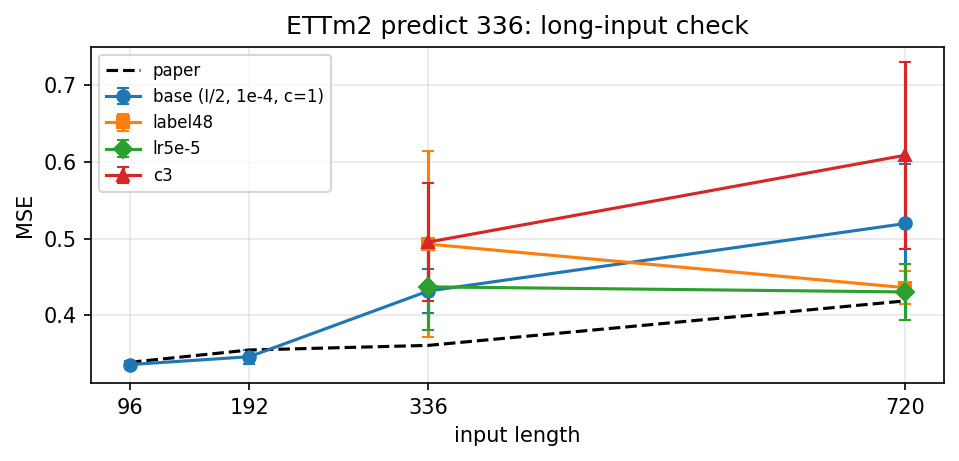

| 입력 | 기준 (디코더 과거 I/2, 학습률 1e-4, c=1) | 디코더 과거 48 | 학습률 5e-5 | c = 3 | 논문 |
|---|---|---|---|---|---|
| 96 | 0.336 ± 0.004 | | | | 0.339 |
| 192 | 0.346 ± 0.009 | | | | 0.355 |
| 336 | 0.432 ± 0.028 | 0.493 ± 0.121 | 0.437 ± 0.057 | 0.496 ± 0.077 | 0.361 |
| 720 | 0.520 ± 0.078 | **0.436 ± 0.022** | **0.431 ± 0.037** | 0.609 ± 0.122 | 0.419 |

- 입력 720은 학습률을 절반으로 낮추거나 디코더 과거를 48로 줄이면 논문(0.419)에 가까워지고 흔들림도 줄었습니다. 긴 입력에서 학습이 불안정했던 것으로 보입니다.
- 입력 336은 어떤 변형으로도 좋아지지 않았고, 실행마다 흔들림도 큽니다. c를 3으로 늘리면 두 길이 모두 더 나빠졌습니다.

**23-4 · 인코더가 고르는 지연** (ETTm2, 입력 96 · 192 · 336 · 672 → 예측 96, 인코더 마지막 층의 상위 10개 지연)

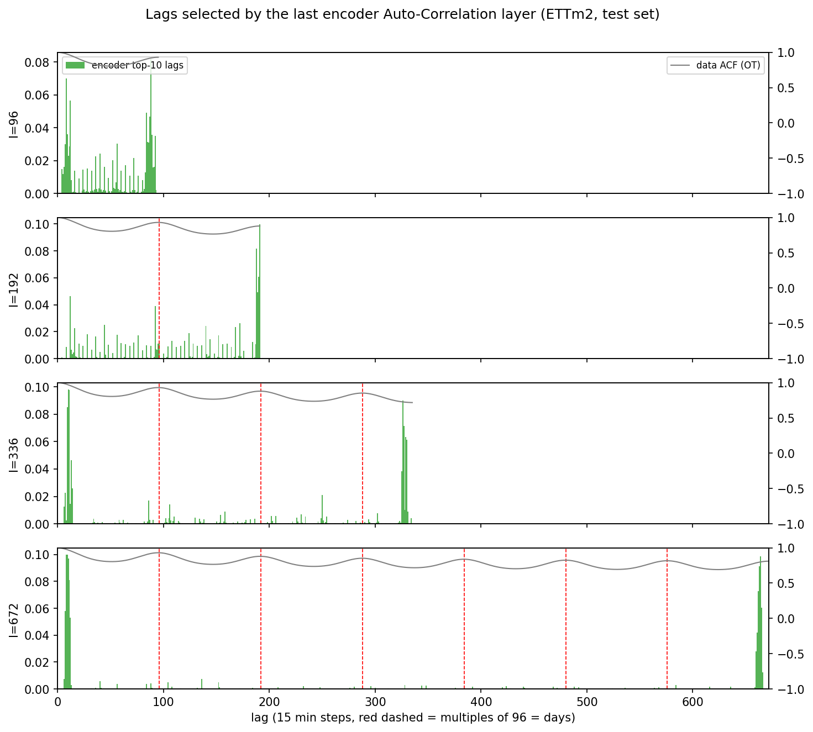

| 입력 | 가장 자주 고른 지연 | 96의 배수 ±3 안의 비율 (무작위 ≈ 0.07) |
|---|---|---|
| 96 | 88, 8, 12, 84, 87, 9 | - |
| 192 | 191, 188, 190, 189, 12, 92 | 0.246 |
| 336 | 10, 11, 326, 9, 327, 329 | 0.003 |
| 672 | 8, 9, 664, 10, 663, 11 | 0.000 |

- 회색 선(데이터 OT의 자기상관)은 96, 192, 288…에서 뚜렷한 봉우리가 있어 **데이터에는 하루 주기가 분명히 있습니다**.
- 그런데 인코더는 입력 길이와 상관없이 **지연 8~11**과 그 원형 거울상(I − 8~11)만 골랐습니다. 입력 192에서만 92 근처가 조금 보입니다.
- 거울상이 짝으로 나오는 것은 원형 자기상관의 대칭(R(τ) = R(L − τ)) 때문이고, 이것은 예상대로 확인되었습니다.
- 앞서 재현한 Figure 6(디코더)에서는 고른 지연이 약 95~100칸 간격으로 몰려 하루 주기와 맞았습니다. 따라서 "Auto-Correlation이 주기를 찾는다"는 주장은 **디코더에서는 맞고, 인코더 마지막 층에서는 맞지 않습니다.** 인코더는 짧은 지연으로 국소 패턴을 모으는 쪽으로 학습된 것으로 보입니다.

**다음 단계**: 비교 모델(Transformer · Informer · Reformer · LogTrans)을 구현해 Table 1·2 비교 열, Table 3, Table 9를 재현.

## 5. 시각화

모든 그래프는 직접 구현 모델(각 설정의 첫 번째 반복, run 0)로 그렸으며, 노트북 섹션 2, 3, 11에서 생성됩니다. 값은 정규화된 스케일이고, 예측 그래프는 마지막 변수(OT, 오일 온도) 기준입니다.

### 5-1. Series Decomposition 블록 동작 확인 (인공 신호)
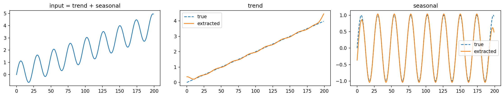

직선(추세)과 주기 24 사인파(계절)를 더한 신호를 커널 25 이동평균 분해 블록에 넣은 결과입니다. 두 성분이 정확하게 분리됩니다.
다만 **양 끝(처음과 마지막 약 12개 시점)에서는 오차가 생깁니다.** 길이를 유지하려고 첫 값과 마지막 값을 반복해서 패딩하기 때문으로, 이동평균 기반 분해의 한계입니다.

### 5-2. FFT 기반 자기상관 (인공 신호)
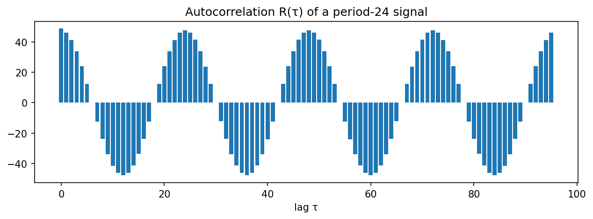

주기 24 신호의 자기상관 $\mathcal{R}(\tau)$를 FFT로 계산한 결과입니다. $\tau = 24, 48, 72$에서 값이 다시 커집니다. 즉 **자기상관이 큰 지연이 곧 주기**이며, Auto-Correlation은 이 지연들을 골라 정보를 모읍니다 (논문 식 5~8). 같은 노트북 셀에서 FFT 결과가 직접 계산한 값과 일치함도 확인했습니다.

### 5-3. 예측 결과 (논문 Figure 8 형식)
**입력 96 → 예측 96**
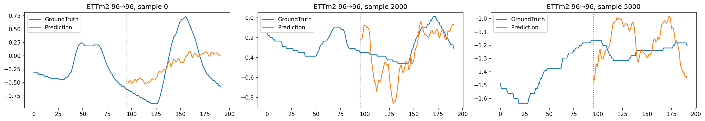

**입력 96 → 예측 336**
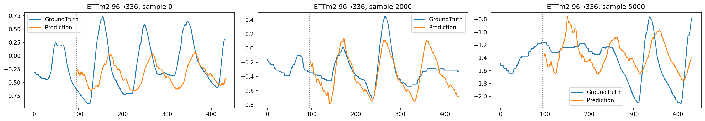

점선 왼쪽이 입력 96개, 오른쪽이 예측 구간입니다 (파랑: 실제값, 주황: 예측값).
- 예측 336에서는 **하루 주기(96시점 = 24시간)의 반복 패턴을 예측 구간 끝까지 이어 갑니다.** sample 2000은 마루와 골의 위치를 잘 맞혔습니다.
- 반면 sample 0처럼 **진폭을 작게 예측하거나 위상이 조금 늦는 경우**가 있고, sample 5000처럼 입력 구간에 뚜렷한 주기가 없으면 예측이 어긋납니다.
- 예측 96은 입력이 거의 단조롭게 변하는 구간에서 큰 변화를 맞히지 못하는 사례가 보입니다. 표에서 예측 96의 오차가 작은 것은 예측 구간이 짧아 오차가 누적되지 않기 때문입니다.

### 5-4. 디코더 출력 분해 (논문 Figure 4 형식)
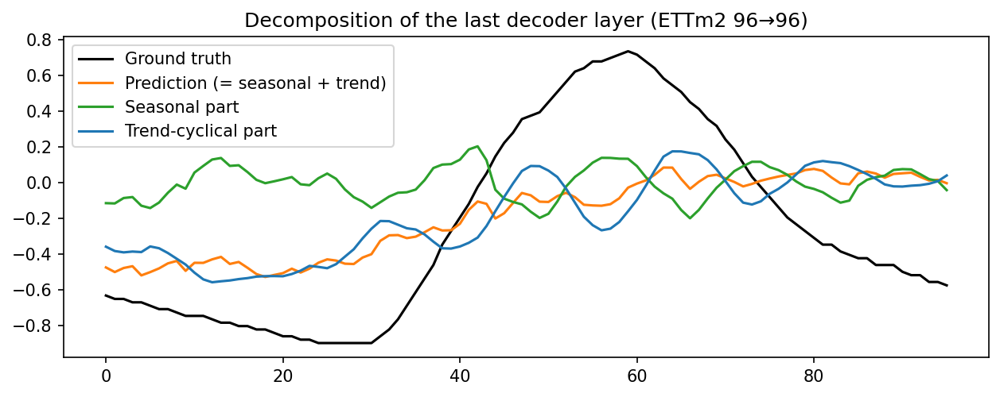

최종 예측(주황)은 디코더가 누적한 **추세 성분(파랑)**과 마지막 층의 **계절 성분(초록)**의 합입니다. 계절 성분은 0 주변의 진동을, 추세 성분은 수준(level)의 변화를 담당하도록 분리되어 있음을 볼 수 있습니다. 이 샘플은 실제값(검정)의 큰 상승을 따라가지 못한 사례로, 5-3의 sample 0과 같은 입력입니다.

### 5-5. 학습된 지연 분포 (논문 Figure 6 형식)
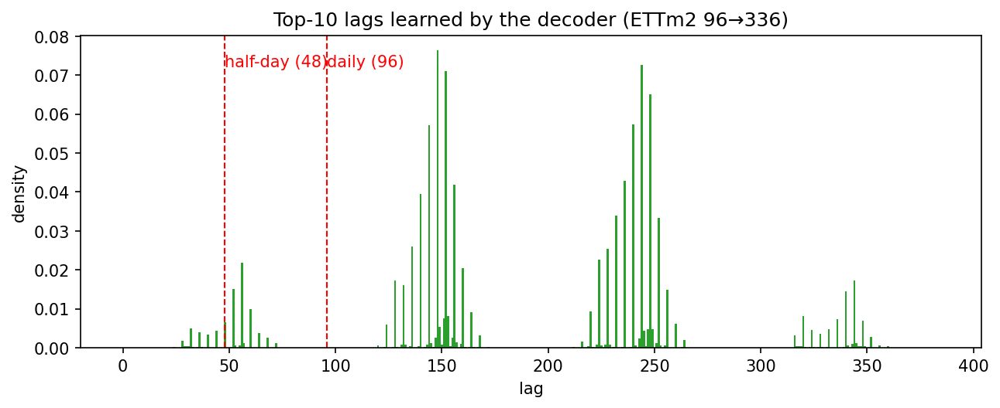

테스트 샘플마다 디코더의 inner Auto-Correlation이 고른 상위 10개 지연을 모은 히스토그램입니다 (예측 336, 디코더 길이 48 + 336 = 384).
- 선택된 지연이 **약 55, 150, 245, 345 근처에 몰려 있고, 서로 약 95~100 간격**입니다. 15분 간격 데이터에서 96은 하루이므로, 모델이 **하루 주기를 기준으로 정보를 모으고 있다**고 해석할 수 있습니다.
- 다만 몰린 위치가 96의 정확한 배수(96, 192, 288)는 아닙니다. 디코더 입력의 예측 구간은 0(계절 초기값)으로 채워진 상태에서 시작하고, 자기상관이 원형(circular)으로 계산되기 때문에 지연 값 자체보다 **지연들 사이의 간격**을 보는 것이 맞습니다. 그래프의 빨간 점선(48, 96)은 참고선이며, 분포의 간격과 비교하는 용도로 보시면 됩니다.

## 6. 구현 검증

모듈 이름을 공식 코드와 같게 구성해, 공식 모델의 가중치를 직접 구현한 모델에 그대로 불러올 수 있게 했습니다.
같은 가중치와 같은 입력에서 두 모델의 출력을 비교한 결과는 다음과 같습니다.

| 비교 항목 | 결과 |
|---|---|
| 추론 모드 출력 (샘플별 지연 선택) | 최대 오차 0.0 |
| 학습 모드 출력 (배치 공통 지연 선택, dropout 0) | 최대 오차 0.0 |
| 데이터 로더 (ETTm2 train / val / test) | 샘플 수 34369 / 11425 / 11425, 값 일치 |

## 7. 논문과 공식 코드의 차이

구현 과정에서 확인한 차이입니다. 직접 구현은 모두 공식 코드를 따랐습니다.

| # | 논문 | 공식 코드 |
|---|---|---|
| 1 | 식 (2): 입력의 뒤쪽 절반만 분해 | 입력 전체를 분해한 뒤 마지막 `label_len`개 사용 |
| 2 | 식 (4): 추세마다 사영 W 세 개 | 세 추세를 더한 뒤 사영 하나 (Conv1d, kernel 3) |
| 3 | Algorithm 4: 추론 시 배치 평균 지연 | 추론 시 샘플별 지연 |
| 4 | 학습률 스케줄 언급 없음 | epoch마다 절반 |
| 5 | 데이터셋별 학습 epoch 언급 없음 | Weather, Traffic, Exchange 일부는 1~3 epoch |
| 6 | ETT 6:2:2 분할 | 12개월 / 4개월 / 4개월 (한 달 30일) |

## 8. 재현 시 겪은 이슈 (공식 코드 실행 환경)

| 이슈 | 원인 | 해결 |
|---|---|---|
| `ModuleNotFoundError: reformer_pytorch` | 비교 모델(Reformer)용 라이브러리 미설치, `requirements.txt`에 버전 고정 없음 | `pip install reformer_pytorch` |
| `AttributeError: np.Inf` | NumPy 2.0에서 `np.Inf` 삭제 | `utils/tools.py`의 `np.Inf` → `np.inf` |
| `freq='t'` 해석 오류 가능성 | 최신 pandas에서 `'t'` 표기 제거 | 직접 구현에서는 시간 특징을 pandas 없이 직접 계산 |

## 9. 실행 환경

- Google Colab, NVIDIA A100 40GB
- Python 3, PyTorch 2.11.0 (CUDA 13.0)

## 참고

```bibtex
@inproceedings{wu2021autoformer,
  title={Autoformer: Decomposition Transformers with {Auto-Correlation} for Long-Term Series Forecasting},
  author={Haixu Wu and Jiehui Xu and Jianmin Wang and Mingsheng Long},
  booktitle={Advances in Neural Information Processing Systems},
  year={2021}
}
```
