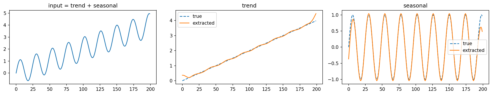
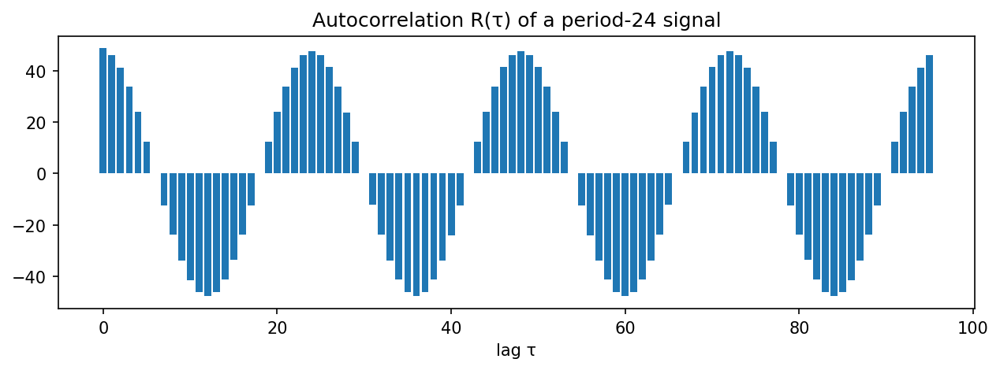
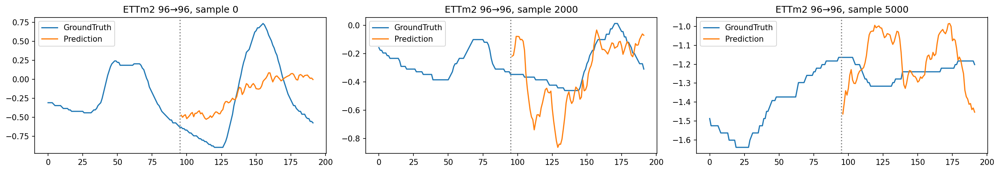
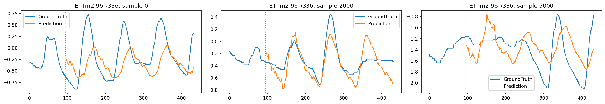
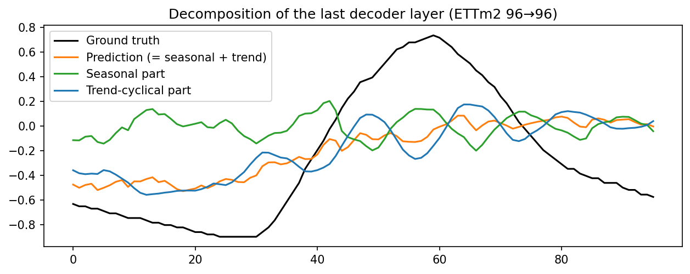
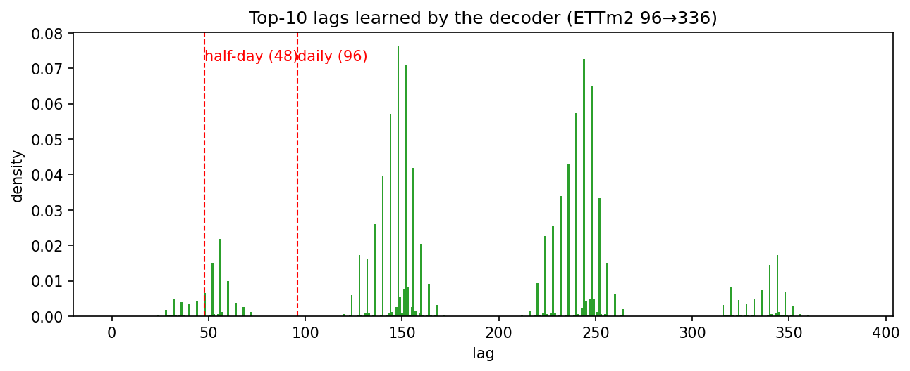

# Autoformer Reproduction

[](https://colab.research.google.com/github/HwangDaekyung/Autoformer_reproduction/blob/main/notebooks/Autoformer_from_scratch.ipynb)

**Autoformer: Decomposition Transformers with Auto-Correlation for Long-Term Series Forecasting** (Wu et al., NeurIPS 2021)를 직접 구현하고 논문 결과를 재현한 저장소입니다.

- 논문: https://arxiv.org/abs/2106.13008
- 공식 코드: https://github.com/thuml/Autoformer

공식 코드를 import하지 않고 **데이터 로더, 모델, 학습 루프를 모두 직접 구현**했습니다. 구현이 맞는지는 공식 코드와 같은 가중치를 넣었을 때 출력이 일치하는지로 검증했습니다.

---

## 1. 구성

```
Autoformer_reproduction/
├── README.md
├── notebooks/
│   └── Autoformer_from_scratch.ipynb   # 직접 구현 + 실험 노트북 (Colab)
└── results/
    ├── official_result.txt             # 공식 코드 실행 원본 기록
    ├── official_results.csv            # 공식 코드 결과 정리
    ├── my_results.csv                  # 직접 구현 결과
    └── figures/                        # 시각화 (5장)
```

노트북 구성은 다음과 같습니다.

| 섹션 | 내용 | 논문 대응 |
|---|---|---|
| 1 | 데이터 로더 (분할, 정규화, 시간 특징, 슬라이딩 윈도우) | 4장 Datasets |
| 2 | Series Decomposition 블록 | 3.1절, 식 (1) |
| 3 | Auto-Correlation 메커니즘 (FFT, Top-k 지연, Time Delay Aggregation) | 3.2절, 식 (5)~(8) |
| 4 | 임베딩 (위치 임베딩 없음) | Appendix G.2 |
| 5 | 인코더 · 디코더 | 식 (3), (4) |
| 6 | 전체 모델 (디코더 입력 초기화) | 식 (2), Figure 1 |
| 7 | 공식 코드와 출력 일치 검증 | |
| 8 | 학습 · 평가 루프 | 4장 Implementation details |
| 9 | 실험 실행 | Table 1, Table 10 |
| 10 | 논문 수치와 비교 | Table 10 |
| 11 | 시각화 (예측, 분해, 학습된 주기) | Figure 4, 6, 8 |

## 2. 실행 방법

1. **데이터 준비**: 공식 저장소 README의 Google Drive 링크에서 6개 데이터셋을 받아 Google Drive의 `WORK_DIR/Autoformer/dataset/` 아래에 압축을 풉니다.
   ```
   dataset/
   ├── ETT-small/ETTm2.csv
   ├── electricity/electricity.csv
   ├── exchange_rate/exchange_rate.csv
   ├── traffic/traffic.csv
   ├── weather/weather.csv
   └── illness/national_illness.csv
   ```
2. 위의 **Open In Colab** 배지로 노트북을 열고, 런타임을 GPU로 설정합니다.
3. 섹션 0의 `WORK_DIR`를 본인 Drive 경로로 바꿉니다.
4. `QUICK_TEST = True`로 전체 실행해 오류가 없는지 확인합니다.
5. `QUICK_TEST = False`로 바꾸고 섹션 9의 `run_experiment('ETTm2')` 등을 실행합니다.
   - 결과는 실험마다 `WORK_DIR/my_autoformer/results.csv`에 저장되며, 연결이 끊겨도 다시 실행하면 끝난 실험은 건너뜁니다.
6. 섹션 7(공식 코드 비교)을 실행하려면 공식 저장소를 `WORK_DIR/Autoformer`에 clone해 둡니다.

## 3. 실험 설정

| 항목 | 값 |
|---|---|
| 입력 길이 / 디코더 과거 길이 | 96 / 48 (ILI: 36 / 18) |
| 예측 길이 | 96, 192, 336, 720 (ILI: 24, 36, 48, 60) |
| 모델 | d_model 512, head 8, 인코더 2층, 디코더 1층, d_ff 2048, 이동평균 커널 25, dropout 0.05 |
| 학습 | MSE 손실, Adam (lr 1e-4), batch 32, 최대 10 epoch, early stopping patience 3 |
| 학습률 스케줄 | epoch마다 절반 (공식 코드 `lradj=type1`) |
| 반복 | 3회 (시드 2021로 시작) |

데이터셋별 설정은 공식 `scripts/`를 따랐습니다.

| 데이터셋 | 변수 수 | factor (c) | freq | 비고 |
|---|---|---|---|---|
| ETTm2 | 7 | 1 | t (분) | |
| Electricity | 321 | 3 | h | |
| Exchange | 8 | 3 | h | 예측 192, 336은 1 epoch |
| Traffic | 862 | 3 | h | 3 epoch |
| Weather | 21 | 3 | h | 예측 96은 2 epoch |
| ILI | 7 | 3 | h | 입력 36 |

## 4. 결과

### ETTm2 (다변량, input-96)

| 예측 길이 | 논문 MSE | 공식 코드 MSE | **내 구현 MSE** | 논문 MAE | 공식 코드 MAE | **내 구현 MAE** |
|---|---|---|---|---|---|---|
| 96  | 0.255 ± 0.020 | 0.259 ± 0.033 | **0.228 ± 0.008** | 0.339 ± 0.020 | 0.329 ± 0.020 | **0.312 ± 0.008** |
| 192 | 0.281 ± 0.027 | 0.278 ± 0.001 | **0.274 ± 0.004** | 0.340 ± 0.025 | 0.336 ± 0.001 | **0.333 ± 0.003** |
| 336 | 0.339 ± 0.018 | 0.335 ± 0.004 | **0.339 ± 0.008** | 0.372 ± 0.015 | 0.372 ± 0.003 | **0.374 ± 0.006** |
| 720 | 0.422 ± 0.015 | 0.422 ± 0.007 | **0.427 ± 0.010** | 0.419 ± 0.010 | 0.419 ± 0.006 | **0.421 ± 0.006** |

- 논문 값은 Table 10의 평균 ± 표준편차입니다.
- 공식 코드와 내 구현 값은 같은 환경(Colab A100)에서 얻은 3회 평균 ± 표본 표준편차입니다. 설정은 공식 `scripts/ETT_script/Autoformer_ETTm2.sh`와 같게 맞췄습니다 (`factor 1`, `freq t`).
- 원본 기록: [`results/official_result.txt`](results/official_result.txt), [`results/official_results.csv`](results/official_results.csv), [`results/my_results.csv`](results/my_results.csv)

### 해석

**1. 공식 코드는 논문을 재현했습니다.** 8개 수치 모두 논문의 평균 ± 표준편차 범위 안에 들어왔고, 예측 336·720은 평균이 소수점 셋째 자리까지 거의 같습니다.

**2. 직접 구현도 예측 192·336·720에서 논문을 재현했습니다.** 6개 수치 모두 논문 범위 안이고, 공식 코드와의 평균 차이는 MSE 기준 0.004 이하입니다.

**3. 예측 96에서는 내 구현이 논문보다 낮은(좋은) 오차를 냈습니다.** MSE 0.228은 논문 범위(0.235~0.275)의 아래쪽 바깥입니다. 다만 이 차이는 구현 오류라기보다 **실행마다 결과가 크게 흔들리는 설정**에서 생긴 것으로 봅니다.
- 공식 코드도 예측 96에서만 3회 결과가 0.229, 0.254, 0.293으로 크게 흔들렸고, 첫 실행(0.229)은 내 구현 평균과 거의 같습니다.
- 논문 Table 10에서도 예측 96의 표준편차가 상대적으로 큽니다.
- 섹션 7에서 같은 가중치·같은 입력에 대해 두 구현의 출력이 일치함을 확인했으므로, 결과 차이는 모델 정의가 아니라 무작위성(초기화, 배치 순서, GPU 연산)에서 온 것으로 해석할 수 있습니다.
- 3회 반복은 표본이 적어서, 시드를 늘려 반복하면 두 구현의 분포가 겹치는지 더 확실히 확인할 수 있습니다.

**4. 학습이 매우 빨리 수렴합니다.** 내 구현 12회 실험 중 10회가 **1 epoch에서 검증 손실이 가장 낮았고**, early stopping(patience 3)으로 4 epoch 만에 멈췄습니다. 학습률이 epoch마다 절반으로 줄어드는 스케줄과 맞물려, 사실상 첫 epoch의 모델이 최종 모델이 됩니다.

**5. 학습 시간**: 실험 1회당 평균 145초(예측 96) ~ 366초(예측 720), 12회 전체 약 46분 (A100). 내 구현은 epoch마다 테스트 구간을 평가하지 않아 공식 코드보다 짧습니다.

### 6개 데이터셋 전체 (직접 구현, 다변량)

| 데이터셋 | 예측 | 논문 MSE | **내 구현 MSE** | 논문 MAE | **내 구현 MAE** | 논문 범위 안 (MSE) |
|---|---|---|---|---|---|---|
| ETTm2 | 96 | 0.255 ± 0.020 | 0.228 ± 0.008 | 0.339 ± 0.020 | 0.312 ± 0.008 | 아래쪽 바깥 (더 좋음) |
| ETTm2 | 192 | 0.281 ± 0.027 | 0.274 ± 0.004 | 0.340 ± 0.025 | 0.333 ± 0.003 | 안 |
| ETTm2 | 336 | 0.339 ± 0.018 | 0.339 ± 0.008 | 0.372 ± 0.015 | 0.374 ± 0.006 | 안 |
| ETTm2 | 720 | 0.422 ± 0.015 | 0.427 ± 0.010 | 0.419 ± 0.010 | 0.421 ± 0.006 | 안 |
| Electricity | 96 | 0.201 ± 0.003 | 0.204 ± 0.011 | 0.317 ± 0.004 | 0.319 ± 0.011 | 안 |
| Electricity | 192 | 0.222 ± 0.003 | 0.228 ± 0.002 | 0.334 ± 0.004 | 0.337 ± 0.002 | 위쪽 바깥 (+0.006) |
| Electricity | 336 | 0.231 ± 0.006 | 0.246 ± 0.004 | 0.338 ± 0.004 | 0.350 ± 0.005 | 위쪽 바깥 (+0.015) |
| Electricity | 720 | 0.254 ± 0.007 | 0.352 ± 0.072 | 0.361 ± 0.008 | 0.412 ± 0.033 | 위쪽 바깥 (+0.098) |
| Exchange | 96 | 0.197 ± 0.019 | 0.157 ± 0.012 | 0.323 ± 0.012 | 0.289 ± 0.012 | 아래쪽 바깥 (더 좋음) |
| Exchange | 192 | 0.300 ± 0.020 | 0.309 ± 0.037 | 0.369 ± 0.016 | 0.403 ± 0.023 | 안 |
| Exchange | 336 | 0.509 ± 0.041 | 0.435 ± 0.025 | 0.524 ± 0.016 | 0.492 ± 0.016 | 아래쪽 바깥 (더 좋음) |
| Exchange | 720 | 1.447 ± 0.084 | 1.128 ± 0.028 | 0.941 ± 0.028 | 0.826 ± 0.014 | 아래쪽 바깥 (더 좋음) |
| Traffic | 96 | 0.613 ± 0.028 | 0.631 ± 0.007 | 0.388 ± 0.012 | 0.395 ± 0.002 | 안 |
| Traffic | 192 | 0.616 ± 0.042 | 0.650 ± 0.014 | 0.382 ± 0.020 | 0.410 ± 0.009 | 안 |
| Traffic | 336 | 0.622 ± 0.016 | 0.639 ± 0.017 | 0.337 ± 0.011 | 0.401 ± 0.013 | 위쪽 바깥 (+0.017) |
| Traffic | 720 | 0.660 ± 0.025 | 0.686 ± 0.036 | 0.408 ± 0.015 | 0.426 ± 0.024 | 위쪽 바깥 (+0.026) |
| Weather | 96 | 0.266 ± 0.007 | 0.287 ± 0.026 | 0.336 ± 0.006 | 0.351 ± 0.015 | 위쪽 바깥 (+0.021) |
| Weather | 192 | 0.307 ± 0.024 | 0.292 ± 0.006 | 0.367 ± 0.022 | 0.351 ± 0.003 | 안 |
| Weather | 336 | 0.359 ± 0.035 | 0.355 ± 0.011 | 0.395 ± 0.031 | 0.389 ± 0.010 | 안 |
| Weather | 720 | 0.419 ± 0.017 | 0.431 ± 0.019 | 0.428 ± 0.014 | 0.435 ± 0.015 | 안 |
| ILI | 24 | 3.483 ± 0.107 | 3.837 ± 0.255 | 1.287 ± 0.018 | 1.410 ± 0.062 | 위쪽 바깥 (+0.354) |
| ILI | 36 | 3.103 ± 0.139 | 3.564 ± 0.125 | 1.148 ± 0.025 | 1.312 ± 0.028 | 위쪽 바깥 (+0.461) |
| ILI | 48 | 2.669 ± 0.151 | 3.141 ± 0.099 | 1.085 ± 0.037 | 1.217 ± 0.024 | 위쪽 바깥 (+0.472) |
| ILI | 60 | 2.770 ± 0.085 | 3.194 ± 0.228 | 1.125 ± 0.019 | 1.226 ± 0.019 | 위쪽 바깥 (+0.424) |

- 3회 평균 ± 표본 표준편차, Colab A100. 원본: [`results/my_results.csv`](results/my_results.csv) (72회 실험, 학습 시간 합계 약 3.5시간)
- ETTm2 외 5개 데이터셋은 **직접 구현만** 실행했고, 같은 환경의 공식 코드 결과는 없습니다.

**해석**

- **24개 설정 중 MSE 기준 10개가 논문 범위 안**, 4개는 논문보다 좋고(범위 아래쪽), 10개는 논문보다 나쁩니다(범위 위쪽).
- **Weather·ETTm2·Traffic(96, 192)은 대체로 재현**되었습니다.
- **Exchange는 논문보다 오차가 크게 낮습니다**(예측 720: 1.128 vs 1.447). 공식 스크립트대로 예측 192·336은 1 epoch만 학습했는데도 그렇습니다. 실행 환경(라이브러리 버전 등)에 따른 차이일 수 있으나 원인은 확인하지 못했습니다.
- **ILI는 4개 예측 길이 모두 논문보다 MSE가 0.35~0.47 높습니다.** 3회 반복 모두 같은 방향이라 단순한 우연으로 보기는 어렵습니다. ILI는 전체가 966개 시점(주 단위)뿐이라 테스트 샘플이 170개 남짓이고 결과가 민감합니다.
- **Electricity 720은 실행마다 결과가 크게 흔들렸습니다**(0.291, 0.334, 0.431).
- **Traffic 336의 MAE**는 논문(0.337)보다 0.064 높습니다. 논문 표에서는 Traffic MAE가 192(0.382)보다 336(0.337)에서 오히려 낮아지는 특이한 패턴을 보입니다.

**구현이 원인인지 확인한 것**: 모델은 공식 코드와 같은 가중치에서 출력이 일치하고(6장), 데이터 로더도 ETTm2와 custom 형식(ILI와 같은 구조의 인공 데이터) 모두에서 공식 로더와 샘플 수·값이 일치함을 확인했습니다. 남은 차이를 가르려면 **같은 환경에서 공식 코드로 ILI·Electricity를 돌려 비교**하는 것이 다음 단계입니다. 공식 코드도 같은 결과가 나오면 환경·무작위성 문제, 다르게 나오면 학습 과정의 차이입니다.

## 5. 시각화

모든 그래프는 직접 구현 모델(각 설정의 첫 번째 반복, run 0)로 그렸으며, 노트북 섹션 2, 3, 11에서 생성됩니다. 값은 정규화된 스케일이고, 예측 그래프는 마지막 변수(OT, 오일 온도) 기준입니다.

### 5-1. Series Decomposition 블록 동작 확인 (인공 신호)


직선(추세)과 주기 24 사인파(계절)를 더한 신호를 커널 25 이동평균 분해 블록에 넣은 결과입니다. 두 성분이 정확하게 분리됩니다.
다만 **양 끝(처음과 마지막 약 12개 시점)에서는 오차가 생깁니다.** 길이를 유지하려고 첫 값과 마지막 값을 반복해서 패딩하기 때문으로, 이동평균 기반 분해의 한계입니다.

### 5-2. FFT 기반 자기상관 (인공 신호)


주기 24 신호의 자기상관 $\mathcal{R}(\tau)$를 FFT로 계산한 결과입니다. $\tau = 24, 48, 72$에서 값이 다시 커집니다. 즉 **자기상관이 큰 지연이 곧 주기**이며, Auto-Correlation은 이 지연들을 골라 정보를 모읍니다 (논문 식 5~8). 같은 노트북 셀에서 FFT 결과가 직접 계산한 값과 일치함도 확인했습니다.

### 5-3. 예측 결과 (논문 Figure 8 형식)
**입력 96 → 예측 96**


**입력 96 → 예측 336**


점선 왼쪽이 입력 96개, 오른쪽이 예측 구간입니다 (파랑: 실제값, 주황: 예측값).
- 예측 336에서는 **하루 주기(96시점 = 24시간)의 반복 패턴을 예측 구간 끝까지 이어 갑니다.** sample 2000은 마루와 골의 위치를 잘 맞혔습니다.
- 반면 sample 0처럼 **진폭을 작게 예측하거나 위상이 조금 늦는 경우**가 있고, sample 5000처럼 입력 구간에 뚜렷한 주기가 없으면 예측이 어긋납니다.
- 예측 96은 입력이 거의 단조롭게 변하는 구간에서 큰 변화를 맞히지 못하는 사례가 보입니다. 표에서 예측 96의 오차가 작은 것은 예측 구간이 짧아 오차가 누적되지 않기 때문입니다.

### 5-4. 디코더 출력 분해 (논문 Figure 4 형식)


최종 예측(주황)은 디코더가 누적한 **추세 성분(파랑)**과 마지막 층의 **계절 성분(초록)**의 합입니다. 계절 성분은 0 주변의 진동을, 추세 성분은 수준(level)의 변화를 담당하도록 분리되어 있음을 볼 수 있습니다. 이 샘플은 실제값(검정)의 큰 상승을 따라가지 못한 사례로, 5-3의 sample 0과 같은 입력입니다.

### 5-5. 학습된 지연 분포 (논문 Figure 6 형식)


테스트 샘플마다 디코더의 inner Auto-Correlation이 고른 상위 10개 지연을 모은 히스토그램입니다 (예측 336, 디코더 길이 48 + 336 = 384).
- 선택된 지연이 **약 55, 150, 245, 345 근처에 몰려 있고, 서로 약 95~100 간격**입니다. 15분 간격 데이터에서 96은 하루이므로, 모델이 **하루 주기를 기준으로 정보를 모으고 있다**고 해석할 수 있습니다.
- 다만 몰린 위치가 96의 정확한 배수(96, 192, 288)는 아닙니다. 디코더 입력의 예측 구간은 0(계절 초기값)으로 채워진 상태에서 시작하고, 자기상관이 원형(circular)으로 계산되기 때문에 지연 값 자체보다 **지연들 사이의 간격**을 보는 것이 맞습니다. 그래프의 빨간 점선(48, 96)은 참고선이며, 분포의 간격과 비교하는 용도로 보시면 됩니다.

## 6. 구현 검증

모듈 이름을 공식 코드와 같게 구성해, 공식 모델의 가중치를 직접 구현한 모델에 그대로 불러올 수 있게 했습니다.
같은 가중치와 같은 입력에서 두 모델의 출력을 비교한 결과는 다음과 같습니다.

| 비교 항목 | 결과 |
|---|---|
| 추론 모드 출력 (샘플별 지연 선택) | 최대 오차 0.0 |
| 학습 모드 출력 (배치 공통 지연 선택, dropout 0) | 최대 오차 0.0 |
| 데이터 로더 (ETTm2 train / val / test) | 샘플 수 34369 / 11425 / 11425, 값 일치 |

## 7. 논문과 공식 코드의 차이

구현 과정에서 확인한 차이입니다. 직접 구현은 모두 공식 코드를 따랐습니다.

| # | 논문 | 공식 코드 |
|---|---|---|
| 1 | 식 (2): 입력의 뒤쪽 절반만 분해 | 입력 전체를 분해한 뒤 마지막 `label_len`개 사용 |
| 2 | 식 (4): 추세마다 사영 W 세 개 | 세 추세를 더한 뒤 사영 하나 (Conv1d, kernel 3) |
| 3 | Algorithm 4: 추론 시 배치 평균 지연 | 추론 시 샘플별 지연 |
| 4 | 학습률 스케줄 언급 없음 | epoch마다 절반 |
| 5 | 데이터셋별 학습 epoch 언급 없음 | Weather, Traffic, Exchange 일부는 1~3 epoch |
| 6 | ETT 6:2:2 분할 | 12개월 / 4개월 / 4개월 (한 달 30일) |

## 8. 재현 시 겪은 이슈 (공식 코드 실행 환경)

| 이슈 | 원인 | 해결 |
|---|---|---|
| `ModuleNotFoundError: reformer_pytorch` | 비교 모델(Reformer)용 라이브러리 미설치, `requirements.txt`에 버전 고정 없음 | `pip install reformer_pytorch` |
| `AttributeError: np.Inf` | NumPy 2.0에서 `np.Inf` 삭제 | `utils/tools.py`의 `np.Inf` → `np.inf` |
| `freq='t'` 해석 오류 가능성 | 최신 pandas에서 `'t'` 표기 제거 | 직접 구현에서는 시간 특징을 pandas 없이 직접 계산 |

## 9. 실행 환경

- Google Colab, NVIDIA A100 40GB
- Python 3, PyTorch 2.11.0 (CUDA 13.0)

## 참고

```bibtex
@inproceedings{wu2021autoformer,
  title={Autoformer: Decomposition Transformers with {Auto-Correlation} for Long-Term Series Forecasting},
  author={Haixu Wu and Jiehui Xu and Jianmin Wang and Mingsheng Long},
  booktitle={Advances in Neural Information Processing Systems},
  year={2021}
}
```
